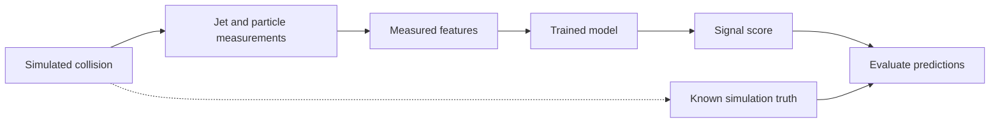
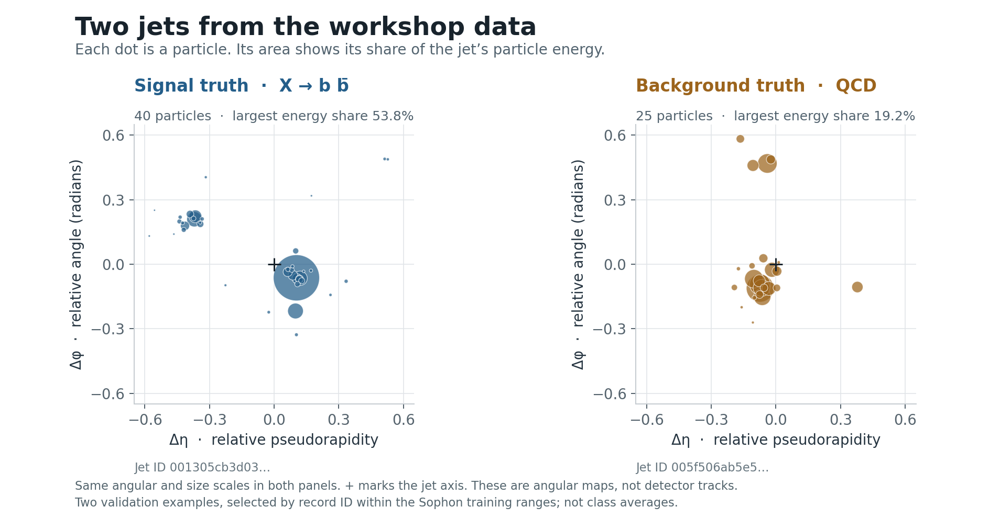

# Understanding the particle prediction problem

**The question:** does a jet resemble a simulated **X → b b̄ decay**, or the **QCD background**?

## Explain it in 30 seconds

> Collisions produce sprays of particles called jets. We use simulated jets whose origins are known. Models learn to recognise the signal from particle measurements. We compare their quality, speed and mistakes.

- **One row = one jet**, with a variable-length list of reconstructed particles.
- **Signal:** a generic simulated particle X decays into a bottom quark and antiquark. X is not necessarily the Higgs.
- **Background:** ordinary quark/gluon jet production, called QCD. These jets can also contain bottom quarks.
- **Truth:** simulation labels signal `0` and QCD `161–187`. Labels train and evaluate models; they never enter prediction features. [Dataset definitions](https://huggingface.co/datasets/jet-universe/jetclass2#dataset-description).

**Prediction and evaluation after training:**

## Look at the data

Each row contains jet-level values and particle lists: `part_energy`, `part_deta`, `part_dphi`. Matching positions describe the same particle. Preprocessing keeps three supplied measurements and calculates five more features.

- **Δη** and **Δφ** describe directions relative to the jet axis, not positions in metres.
- Dot area = share of particle energy. Both panels use the same scales.
- Examples are the first record ID per class within Sophon’s training ranges in validation; they are not class averages.

## Understand the eight features

| Feature | What it measures | Signal example | QCD example |
|---|---|---:|---:|
| `jet_pt` | Momentum perpendicular to the beam (GeV). | 571.1 | 235.3 |
| `jet_sdmass` | Mass after removing soft, wide-angle radiation (GeV). | 146.3 | 55.9 |
| `particle_count` | Number of reconstructed particles inside this jet. | 40 | 25 |
| `energy_sum` | Total energy of those particles (GeV). | 1477.9 | 277.1 |
| `leading_energy_fraction` | Energy share carried by the most energetic particle. | 53.8% | 19.2% |
| `radial_energy_moment` | Energy-weighted angular distance from the jet axis; a spread measure. | 0.1921 | 0.1909 |
| `energy_dispersion` | Energy concentration: higher means fewer particles dominate. Not angular width. | 0.5520 | 0.2968 |
| `ecf2_beta1` | Energy-weighted angular separation of every distinct particle pair. | 0.1026 | 0.1123 |

`basic` uses the first three; `shape` uses all eight. The definitions match [features.py](../src/preprocessing/features.py). Momentum and mass use the usual collider convention c = 1. [Soft Drop](https://arxiv.org/abs/1402.2657) defines the mass-grooming step.

**Point out:** similar radial-moment values, but **53.8% versus 19.2%** leading energy share. Width and energy concentration differ. Higher values do not universally mean “signal”.

## Read the predictions

The baseline runs only logistic regression on the three basic features. Participants choose what to try next: more features, tuning, XGBoost or another classifier. **Sophon** is an optional reference with richer particle inputs; the supplied ONNX integration stays pretrained/frozen, CPU, batch size 1. [Sophon model](https://huggingface.co/jet-universe/sophon).

These example scores were recorded on 12 October. The XGBoost example uses all eight shape features; they are not new results from your basic-feature run.

| Model | Signal jet | QCD jet |
|---|---:|---:|
| Logistic regression · basic | 0.642 | 0.526 |
| XGBoost · shape | 0.699 | 0.665 |
| Sophon · frozen | 0.848 | 0.002 |

Higher scores mean more signal-like, **not calibrated probabilities**. At threshold **0.5**, logistic regression and XGBoost misclassify this QCD jet; Sophon rejects it. Evaluate all jets to compare models.

## Explain a good result

- **Train: 4,000 jets** — learn model parameters using known labels.
- **Validation: 1,000** — compare features and models; choose an approach.
- **Test: 1,000** — evaluate the chosen approach once. Each split is 50/50 signal/QCD, an educational balance rather than real collider prevalence.
- **ROC-AUC:** how well scores rank signal above background; 0.5 is random ordering, 1.0 is perfect ranking.
- **Signal retention / background rejection:** how much signal we keep and background we discard at a chosen threshold.
- **Inference time:** speed matters too; reported laptop timings are approximate comparisons.

**Workshop challenge:** improve preprocessing and models with Codex; explain the quality–speed trade-off in the Site. Classification on simulation does not establish a new particle.

[Exact example values and provenance](assets/jet-examples.json) · [Data and SQL](data.md) · [Workshop instructions](https://ringier-collision-lab.openai.chatgpt.site/workshop)
